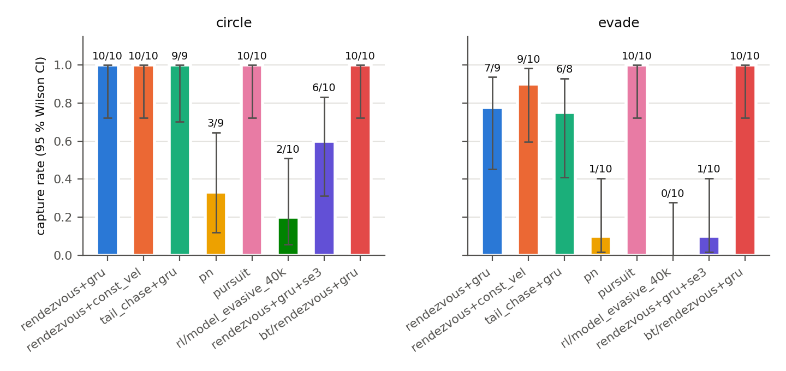
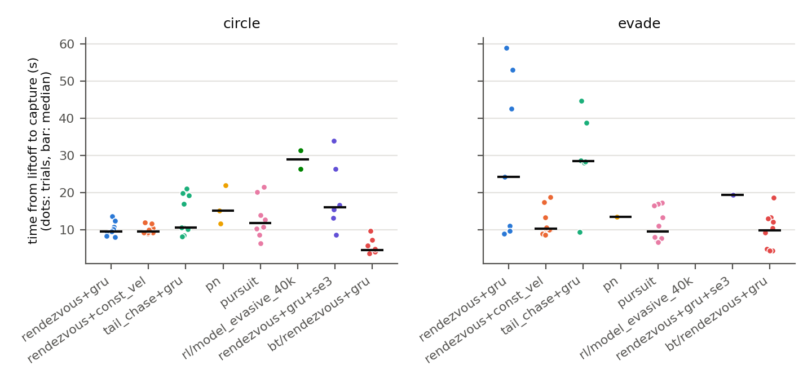

# Interception benchmark

Capture benchmark of every interception method that flies in the two-drone
scene, 10 trials per method and target behaviour, run with
`scripts/run_benchmark.py`. The current numbers are the Gazebo-refereed
campaign of 4–6 Nov 2026 (next section; Findings and Caveats below refer to
it). The odometry-refereed campaign of 30 Oct – 2 Nov
([`benchmarks/2026-10-30_pipeline_vs_pn/`](benchmarks/2026-10-30_pipeline_vs_pn/))
and the June 2026 single-run table are kept for history.

## Gazebo-refereed results (B14, 4–6 Nov 2026): read this first

The same campaign (10 methods, circle and evade, 10 trials each, seed 1) with
`referee: gazebo`: the metrics logger judges range and capture on Gazebo's own
poses of both models (`gz_referee.py`, `drone_interception_sim` be78cf2), so a
trial runs until the vehicles are truly within 1.0 m, while every method still
flies on its own estimates. KF fix included (`interception_estimation` f6c1d90).
200 valid trials (3 infrastructure faults re-run, 35 sim starts). The runner's
independent Gazebo reading agrees with the referee's closest range within
0.09 m in every cell. Data: [`benchmarks/2026-11-04_b14_referee/`](benchmarks/2026-11-04_b14_referee/).

| method | circle captures | liftoff-to-capture median (s) | evade captures | liftoff-to-capture median (s) |
|---|---|---|---|---|
| rendezvous+gru | 8/10 | 10.7 | 4/10 | 21.1 |
| rendezvous+const_vel | 7/10 | 9.8 | 5/10 | 25.4 |
| tail_chase+gru | 3/10 | 14.2 | 5/10 | 29.1 |
| rendezvous+gru+mpc_12state | 8/10 | 14.0 | 7/10 | 11.0 |
| rendezvous+gru+se3 | **10/10** | 10.1 | 4/10 | 10.5 |
| bt/rendezvous+gru | 9/10 | 5.0 | 8/10 | 28.9 |
| pn | 1/10 | 11.3 | 1/10 | 26.8 |
| pursuit | 8/10 | 12.4 | **10/10** | 13.3 |
| pn_int | 6/10 | 7.7 | 2/10 | 8.4 |
| rl/model_evasive_40k | 0/10 | — | 0/10 | — |

Total 106/200 (53 %). The odometry-refereed campaign below declared 156/200;
judged on Gazebo after the fact, only 30 of those declared captures were within
1.0 m (next section). Ten trials per cell: a Wilson 95 % interval on 5/10 is
24–76 %, so only large differences between methods are resolved.

## Gazebo-checked odometry run (B14, 3–4 Nov 2026)

The capture counts in **Results** below are measured on MAVROS odometry. Gazebo's
own poses show that this overstates them: the same campaign, re-run with the
KF fix (`interception_estimation` f6c1d90) and the runner recording Gazebo's
closest centre distance per trial (`true_min_range_m`), gave 152 declared
captures in 200 trials, of which **30 came inside 1.0 m by Gazebo**. At a
declared capture the true range was a median 0.52 m (p90 1.14 m) larger than
the odometry range; the error is mostly the interceptor's EKF height (0.5–0.65 m
off on the ground, up to 1.1 m in flight), while the target's odometry agrees
with Gazebo. A trial ends at the odometry capture, so a method gets no chance to
close the rest. Data: [`benchmarks/2026-11-03_b14_gz_checked/`](benchmarks/2026-11-03_b14_gz_checked/)
(`report/` counts `true_outcome`).

Declared captures of 10 trials, and how many of them Gazebo puts within 1.0 / 1.5 / 2.0 m:

| method | circle: declared | ≤1.0 | ≤1.5 | ≤2.0 | evade: declared | ≤1.0 | ≤1.5 | ≤2.0 |
|---|---|---|---|---|---|---|---|---|
| rendezvous+gru | 10 | 0 | 5 | 8 | 9 | 5 | 7 | 8 |
| rendezvous+const_vel | 10 | 2 | 5 | 10 | 10 | 1 | 3 | 9 |
| tail_chase+gru | 10 | 2 | 5 | 8 | 10 | 3 | 8 | 10 |
| rendezvous+gru+mpc_12state | 10 | 2 | 5 | 10 | 10 | 2 | 7 | 9 |
| rendezvous+gru+se3 | 10 | 2 | 7 | 8 | 4 | 1 | 3 | 4 |
| bt/rendezvous+gru | 10 | 1 | 2 | 9 | 9 | 1 | 7 | 8 |
| pn | 1 | 1 | 1 | 1 | 2 | 0 | 1 | 1 |
| pursuit | 9 | 4 | 6 | 9 | 10 | 2 | 7 | 8 |
| pn_int | 9 | 0 | 7 | 9 | 9 | 1 | 5 | 9 |
| rl/model_evasive_40k | 0 | 0 | 0 | 0 | 0 | 0 | 0 | 0 |

Total 152 declared: 30 within 1.0 m, 91 within 1.5 m, 138 within 2.0 m.
Declared counts are close to the odometry campaign below (SE3 on evade fell from
10 to 4; PN on circle from 4 to 1). Ten trials per cell do not separate methods
whose confirmed counts differ by one or two.

## Setup

- **Scene:** `interception.launch.py`, headless. Interceptor `x500_d435`
  (2.466 kg) spawns at (0, 0); target `x3_uav` at (10, 0) flies a 6 m circle
  at 0.4 rad/s (2.4 m/s) centred 10 m further on, at about 4 m altitude.
- **Scenarios:**
  - `circle`: the scripted circle.
  - `evade`: the same circle, plus a reactive push away from the interceptor
    once it is within 6 m (offset up to 4 m, stronger the closer it gets).
- **Capture:** range ≤ 1.0 m between the two models' origins, sampled at 10 Hz
  by `interception_metrics`. Since 6 Nov judged on Gazebo's own poses
  (`referee: gazebo` in the campaign); the odometry-refereed history table used
  both vehicles' MAVROS odometry in one world frame. No vision in the loop:
  every pipeline method uses the `ground_truth` detector (see B10 in
  `ROADMAP.md`).
- **Outcomes:** `capture`; `timeout` (no capture in 120 s); `miss` (the
  interceptor came back to the ground without a capture: gave up and returned,
  sank, or crashed).
- **Timing:** liftoff-to-capture, from the moment the interceptor is 0.5 m above
  its start height, so arming latency does not count. Take-off does count, and
  it differs by method (see findings).
- **Randomisation:** each trial waits a seeded random delay of 0–15.7 s (one
  target lap) before the method starts, so the target's phase at engagement
  varies. Seed 1, same delays for every method.
- **Hygiene per trial:** the interceptor is back home and disarmed, the target
  is airborne in OFFBOARD, and PX4's preflight check passes; otherwise the sim
  is restarted. Each trial's launches are stopped (and any orphaned stage nodes
  killed) before the next one.

## Methods

| label | what flies the interceptor |
|---|---|
| `pipeline/rendezvous+gru+passthrough+px4_setpoint` | FSM head (`pipeline_fsm`: arm → AUTO.TAKEOFF to 4 m → OFFBOARD pursue/attack → RTL); KF → GRU forecast → rendezvous planner → PX4 position setpoints |
| `pipeline/rendezvous+const_vel+passthrough+px4_setpoint` | same, constant-velocity forecast (GRU ablation) |
| `pipeline/tail_chase+gru+passthrough+px4_setpoint` | same, tail-chase planner |
| `pipeline/rendezvous+gru+mpc_12state+px4_setpoint` | same, with the 12-state jerk-limited OSQP MPC (`interception_mpc` `mpc_12state`) between planner and controller; PX4 tracks the plan's 1.0 s sample |
| `pipeline/rendezvous+gru+passthrough+se3` | same, geometric SE(3) controller (attitude + thrust) instead of PX4 position control; thrust scaled by PX4's hover thrust (0.79), acceleration limit 12 m/s² applied vertical-first |
| `bt/rendezvous+gru` | Behaviour-Tree head (`shaheen_states` `bt_node`, climbs in OFFBOARD) on the rendezvous + GRU reference |
| `pn` | `shaheen_guidance` guidance, June PN law (N = 3, fixed 6 m/s closing, correction added to the measured velocity) |
| `pursuit` | same node, pure pursuit at 6 m/s |
| `pn_int` | same node, textbook constant-speed PN (N = 3) integrated on the commanded velocity at 6 m/s (`law:=pn_int`) |
| `rl/model_evasive_40k` | `shaheen_rl` `policy_head`: the evasive-stage SAC policy (trained in AeroGym against a 0.5 m/s target), velocity commands up to 8 m/s |

## Odometry-refereed results (30 Oct – 2 Nov 2026, superseded)

Captures judged on MAVROS odometry, before the KF fix: kept for history. Use the
Gazebo-refereed table at the top of this file.



| scenario | method | captures | capture rate (95 % Wilson CI) | liftoff-to-capture median [IQR] (s) | closest approach median / max (m) | non-captures |
|---|---|---|---|---|---|---|
| circle | rendezvous+gru | 10/10 | 100 % (72–100) | 9.6 [9.0–10.5] | 0.96 / 1.00 | |
| circle | rendezvous+const_vel | 10/10 | 100 % (72–100) | 9.5 [9.3–10.4] | 0.95 / 0.99 | |
| circle | tail_chase+gru | 10/10 | 100 % (72–100) | 12.6 [10.3–18.7] | 0.99 / 1.00 | |
| circle | rendezvous+gru+mpc | 10/10 | 100 % (72–100) | 13.0 [9.8–15.2] | 0.79 / 0.91 | |
| circle | rendezvous+gru+se3 | 9/10 | 90 % (60–98) | 9.1 [8.6–9.7] | 0.83 / 1.00 | 1 miss |
| circle | **bt**/rendezvous+gru | 10/10 | 100 % (72–100) | **4.6** [4.3–5.5] | 0.97 / 1.00 | |
| circle | pn | 4/10 | 40 % (17–69) | 13.4 [11.1–16.8] | 1.61 / 2.14 | 6 timeout |
| circle | pursuit | 10/10 | 100 % (72–100) | 11.8 [9.0–13.7] | 0.82 / 0.99 | |
| circle | pn_int | 9/10 | 90 % (60–98) | 7.7 [7.1–7.8] | 0.87 / 1.06 | 1 miss |
| circle | rl/model_evasive_40k | 2/10 | 20 % (6–51) | 28.9 [27.6–30.1] | 3.86 / 18.48 | 4 miss, 4 timeout |
| evade | rendezvous+gru | 8/10 | 80 % (49–94) | 22.1 [10.7–45.2] | 0.99 / 1.06 | 2 miss |
| evade | rendezvous+const_vel | 9/10 | 90 % (60–98) | 10.3 [10.0–13.3] | 0.97 / 1.20 | 1 miss |
| evade | tail_chase+gru | 8/10 | 80 % (49–94) | 28.5 [24.3–40.3] | 0.99 / 1.12 | 2 miss |
| evade | rendezvous+gru+mpc | 8/10 | 80 % (49–94) | 11.9 [8.9–15.3] | 0.88 / 1.12 | 2 miss |
| evade | rendezvous+gru+se3 | 10/10 | 100 % (72–100) | 9.3 [8.4–16.9] | 0.78 / 1.00 | |
| evade | **bt**/rendezvous+gru | 10/10 | 100 % (72–100) | 9.9 [4.5–12.9] | 0.96 / 1.00 | |
| evade | pn | 1/10 | 10 % (2–40) | 13.5 | 2.59 / 3.57 | 9 timeout |
| evade | pursuit | 10/10 | 100 % (72–100) | 9.6 [7.7–15.8] | 0.88 / 0.99 | |
| evade | pn_int | 8/10 | 80 % (49–94) | **7.7** [6.8–8.3] | 0.84 / 1.83 | 2 miss |
| evade | rl/model_evasive_40k | 0/10 | 0 % (0–28) | — | 2.39 / 7.46 | 6 miss, 4 timeout |

200 valid trials of 200. Five of them (tail_chase circle t08 and evade t08/t09,
pn circle t02, rendezvous+gru evade t07) never got a healthy scene in the four
October passes and ran on 1 Nov, after the clock-bridge fix (Caveats). The
machine-readable table is
[`report/summary.csv`](benchmarks/2026-10-30_pipeline_vs_pn/report/summary.csv),
and it also gives total time from launch.



Example trajectories (first capture per method; for a method with none, its
closest trial): [circle](benchmarks/2026-10-30_pipeline_vs_pn/report/xy_circle.png),
[evade](benchmarks/2026-10-30_pipeline_vs_pn/report/xy_evade.png). Range against
time: [circle](benchmarks/2026-10-30_pipeline_vs_pn/report/range_circle.png),
[evade](benchmarks/2026-10-30_pipeline_vs_pn/report/range_evade.png).

## Findings

From the Gazebo-refereed campaign at the top of this file (200 trials, 10 per
cell, `benchmarks/2026-11-04_b14_referee/`). Fisher exact tests are two-sided;
"head-declared" means the FSM head (`CAPTURE (range=`) or the BT head (`Target
captured (latched)`) logged a capture before the referee saw one; both then switch
to AUTO.RTL. The guidance node only logs its own check and flies on.

- **The mission heads' early capture declarations are the largest single
  failure.** 33 of the 60 misses followed a capture the FSM or BT head declared
  on its own estimate and then flew home; of their 55 declarations, 22 were true
  captures. In every cell apart from PN and RL, the non-captures' closest true
  approach was a median 1.0–1.6 m. The heads judge capture on the interceptor's
  MAVROS odometry, whose position error at a declared capture is a median 0.52 m
  (B14 odometry run below), mostly the EKF height.
- **Pure pursuit at 6 m/s is the most reliable method:** 18/20 (8/10 circle,
  10/10 evade), no misses, a median 12.4 and 13.3 s from liftoff. Its 2
  non-captures are timeouts on the circle.
- **The June PN law fails:** 2/20, against pursuit's 18/20 (p < 0.001). With
  correct velocities it settles into an orbit around the circling target (17
  timeouts; closest approach median 1.4 m on the circle, 1.8 m under evasion).
  Its June capture came from the odometry-frame bug (B3/B4 in `ROADMAP.md`).
- **Textbook PN (`pn_int`) is the quickest when it captures:** 8/20, in a median
  7.7 s (circle) and 8.4 s (evade) from liftoff, the fastest of all methods. Its
  12 misses passed 1.02–1.81 m from the target (median 1.39 m) and the
  interceptor came down 11–98 s later: these are guidance misses, not early
  declarations.
- **The SE(3) geometric controller is the best on the circle and weak under
  evasion:** 10/10 on the circle (median 10.1 s), 4/10 under evasion (4
  timeouts, 2 misses that came down without a declaration); p = 0.011 between
  the scenarios. On the odometry referee it was 19/20, so its evade captures were
  mostly short of a true one.
- **The Behaviour-Tree head is the strongest mission head:** 17/20 (9/10, 8/10)
  against the FSM head's 12/20 (8/10, 4/10) on the same rendezvous + GRU
  reference; p = 0.16, so not resolved at 10 trials. It is the fastest on the
  circle (median 5.0 s from liftoff, against 10.7 s): the FSM head spends
  3.7–5.3 s in PX4's AUTO.TAKEOFF before pursuing, while the BT climbs on its own
  OFFBOARD setpoints.
- **The OSQP MPC (`mpc_12state`) helps under evasion:** 15/20 (8/10, 7/10),
  against 12/20 for the passthrough pipeline it wraps; under evasion 7/10 in a
  median 11.0 s against 4/10 in 21.1 s (p = 0.37). All 4 of its misses were
  head-declared; on the circle it is slower (14.0 s against 10.7 s).
- **GRU against constant-velocity forecast: no difference** at ground-truth
  detection, 12/20 each (p = 1.0), with similar times (circle 10.7 / 9.8 s,
  evade 21.1 / 25.4 s).
- **Rendezvous beats tail chase on the circle:** 8/10 against 3/10 (p = 0.07);
  all 7 tail-chase misses were head-declared. Under evasion both are 4–5/10.
- **The RL policy does not transfer to this scene:** 0/20, closest approach a
  median 3.3 m (circle) and 3.5 m (evade). It was trained against a 0.5 m/s
  target; here the target flies at 2.4 m/s (C4–C6 in `ROADMAP.md`).
- **Vision in the loop** (`detector:=depth_cc`, not part of this campaign) reaches
  at most 2/5 Gazebo-confirmed captures after the estimator fixes; see B10 in
  `ROADMAP.md`.

Fixes these numbers rest on (details in `ROADMAP.md`): the body-to-world odometry
twist (B3), the SE(3) thrust model and mass (B6, `interception_control` cf5d9d4),
the MPC's warm-started acceleration (B5, `interception_mpc` 2671cf5), the FSM
capture gate (B11, 4784b42), the `/clock` bridge start (B8, 35bce3c), the
target-PX4 start-up fault (B12, `uavros2` c383bc9) and the KF covariance
prediction (B10, `interception_estimation` f6c1d90; every pipeline result before
3 Nov ran on the broken filter).

## Caveats

- Simulation only. Every pipeline method uses the `ground_truth` detector;
  vision is not in this campaign.
- One target speed (2.4 m/s), one geometry, one capture radius (1.0 m between
  model origins, refereed on Gazebo's poses at 10 Hz from a 50 Hz topic).
- The methods are refereed on truth but fly on their own estimates, as a real
  system would; their capture declarations use odometry, which the referee does
  not. This is the main reason for the gap to the odometry-refereed numbers.
- Ten trials per cell: a Wilson 95 % interval on 5/10 is 24–76 %. Only the
  Of the comparisons above, only pursuit against PN and SE(3) circle against
  evade are significant at p < 0.05.
- 3 trial starts were infrastructure faults and were re-run (2 no-liftoff, 1
  scene that could not be made healthy); 35 sim starts in all. Excluding faults
  keeps each valid trial clean, but a method is never run on a degraded scene.
- The campaign shared the machine with other simulation sessions, which was not
  controlled for. Gazebo and PX4 SITL run in lockstep; the ROS controllers run on
  wall-clock timers.
- The odometry-refereed table above (30 Oct – 2 Nov) is kept for history; its
  capture counts are not comparable with the refereed ones.

## Reproduce

```bash
export RMW_IMPLEMENTATION=rmw_fastrtps_cpp RRV_SHIM_BYPASS=1
source ros2_ws/install/setup.bash
python3 ros2_ws/src/drone_interception_sim/scripts/run_benchmark.py \
    ros2_ws/src/drone_interception_sim/benchmarks/campaigns/pipeline_vs_pn.yaml \
    --out ~/benchmarks_runs/pipeline_vs_pn      # resumable: re-run to fill gaps
python3 ros2_ws/src/drone_interception_sim/scripts/analyze_benchmark.py ~/benchmarks_runs/pipeline_vs_pn
```

The runner starts and stops the sim itself, using `partition` and `domain` from
the campaign file, which sets `referee: gazebo`. The refereed campaign took
8 h unattended on 4 Nov (05:14–13:20, one pass), plus one re-run trial on
6 Nov. The
odometry-refereed campaign needed four passes between 30 Oct 05:00 and
31 Oct 05:00 (with pauses for runner fixes), mostly spent on sim restarts; the
`pn_int` rows and the last 5 cells took about an hour on 1 Nov, the
`mpc_12state` rows another hour.

## June 2026 single runs (history)

The first matrix had one or two runs per method on the circle, with the FSM
head. Rendezvous + GRU captured twice in 15.6 and 16.1 s, tail chase + GRU in
15.3 s, rendezvous + const_vel in 12.75 s, and PN in 10.7 s. `pn_lead` as a
position planner timed out at 3.9 m. Those times count from launch, not from
liftoff, and the PN capture depended on the frame bug. Raw rows:
[`benchmarks/interception_results_2026-06-11.csv`](benchmarks/interception_results_2026-06-11.csv).
