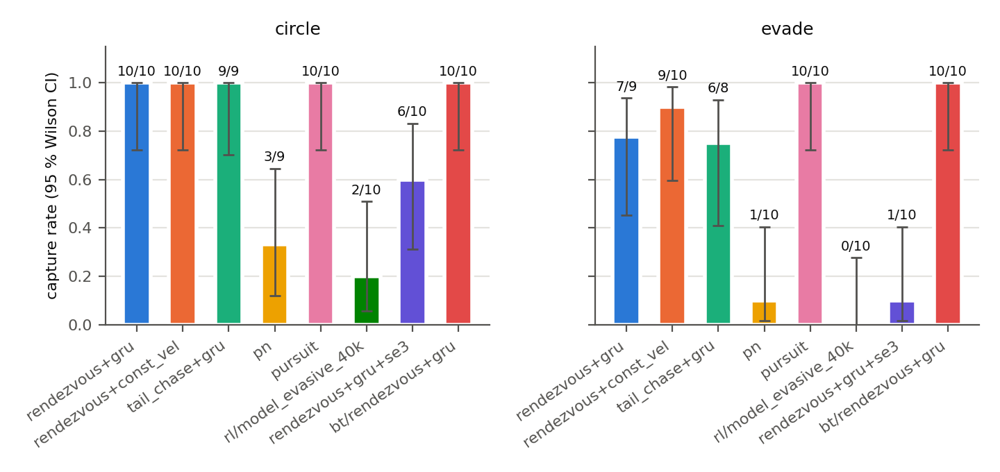
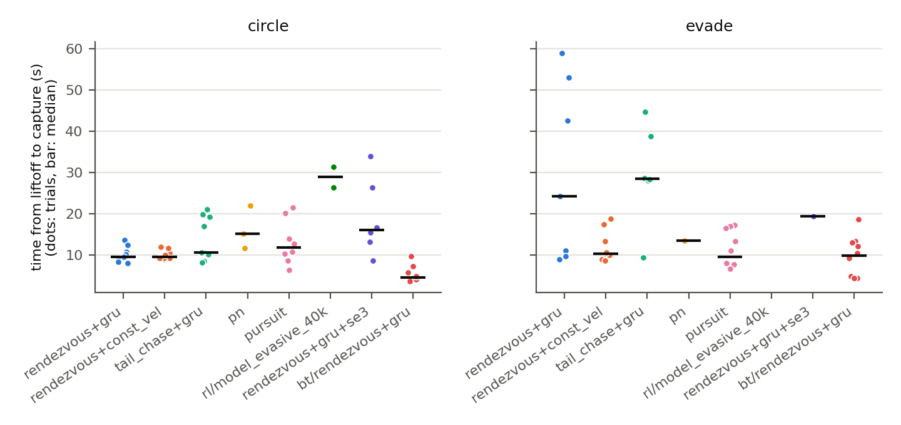

# Interception benchmark

Capture benchmark of every interception method that flies in the two-drone
scene, 10 trials per method and target behaviour. Run 30–31 Oct 2026 with
`scripts/run_benchmark.py`; data, traces and figures are in
[`benchmarks/2026-10-30_pipeline_vs_pn/`](benchmarks/2026-10-30_pipeline_vs_pn/).
It replaces the June 2026 single-run table (kept at the end for history).

## Setup

- **Scene:** `interception.launch.py`, headless. Interceptor `x500_d435`
  (2.466 kg) spawns at (0, 0); target `x3_uav` at (10, 0) flies a 6 m circle
  at 0.4 rad/s (2.4 m/s) centred 10 m further on, at about 4 m altitude.
- **Scenarios:**
  - `circle`: the scripted circle.
  - `evade`: the same circle, plus a reactive push away from the interceptor
    once it is within 6 m (offset up to 4 m, stronger the closer it gets).
- **Capture:** ground-truth range ≤ 1.0 m (both vehicles' odometry in one world
  frame), sampled at 10 Hz by `interception_metrics`. No vision in the loop:
  every pipeline method uses the `ground_truth` detector (see B10 in
  `ROADMAP.md`).
- **Outcomes:** `capture`; `timeout` (no capture in 120 s); `miss` (the
  interceptor came back to the ground without a capture: gave up and returned,
  sank, or crashed).
- **Timing:** liftoff-to-capture, from the moment the interceptor is 0.5 m above
  its start height, so arming latency does not count. Take-off does count, and
  it differs by method (see findings).
- **Randomisation:** each trial waits a seeded random delay of 0–15.7 s (one
  target lap) before the method starts, so the target's phase at engagement
  varies. Seed 1, same delays for every method.
- **Hygiene per trial:** the interceptor is back home and disarmed, the target
  is airborne in OFFBOARD, and PX4's preflight check passes; otherwise the sim
  is restarted. Each trial's launches are stopped (and any orphaned stage nodes
  killed) before the next one.

## Methods

| label | what flies the interceptor |
|---|---|
| `pipeline/rendezvous+gru+passthrough+px4_setpoint` | FSM head (`pipeline_fsm`: arm → AUTO.TAKEOFF to 4 m → OFFBOARD pursue/attack → RTL); KF → GRU forecast → rendezvous planner → PX4 position setpoints |
| `pipeline/rendezvous+const_vel+passthrough+px4_setpoint` | same, constant-velocity forecast (GRU ablation) |
| `pipeline/tail_chase+gru+passthrough+px4_setpoint` | same, tail-chase planner |
| `pipeline/rendezvous+gru+passthrough+se3` | same, geometric SE(3) controller (attitude + thrust) instead of PX4 position control |
| `bt/rendezvous+gru` | Behaviour-Tree head (`d2dtracker_states` `bt_node`, climbs in OFFBOARD) on the rendezvous + GRU reference |
| `pn` | `d2dtracker_interception` guidance, June PN law (N = 3, fixed 6 m/s closing, correction added to the measured velocity) |
| `pursuit` | same node, pure pursuit at 6 m/s |
| `rl/model_evasive_40k` | `d2dtracker_rl` `policy_head`: the evasive-stage SAC policy (trained in AeroGym against a 0.5 m/s target), velocity commands up to 8 m/s |

## Results



| scenario | method | captures | capture rate (95 % Wilson CI) | liftoff-to-capture median [IQR] (s) | closest approach median / max (m) | non-captures |
|---|---|---|---|---|---|---|
| circle | rendezvous+gru | 10/10 | 100 % (72–100) | 9.6 [9.0–10.5] | 0.96 / 1.00 | |
| circle | rendezvous+const_vel | 10/10 | 100 % (72–100) | 9.5 [9.3–10.4] | 0.95 / 0.99 | |
| circle | tail_chase+gru | 9/9 | 100 % (70–100) | 10.6 [10.2–19.3] | 0.99 / 1.00 | |
| circle | rendezvous+gru+se3 | 6/10 | 60 % (31–83) | 16.1 [13.8–24.0] | 0.99 / 4.22 | 4 miss |
| circle | **bt**/rendezvous+gru | 10/10 | 100 % (72–100) | **4.6** [4.3–5.5] | 0.97 / 1.00 | |
| circle | pn | 3/9 | 33 % (12–65) | 15.1 [13.4–18.6] | 1.63 / 2.14 | 6 timeout |
| circle | pursuit | 10/10 | 100 % (72–100) | 11.8 [9.0–13.7] | 0.82 / 0.99 | |
| circle | rl/model_evasive_40k | 2/10 | 20 % (6–51) | 28.9 [27.6–30.1] | 3.86 / 18.48 | 4 miss, 4 timeout |
| evade | rendezvous+gru | 7/9 | 78 % (45–94) | 24.3 [10.3–47.8] | 0.99 / 1.06 | 2 miss |
| evade | rendezvous+const_vel | 9/10 | 90 % (60–98) | 10.3 [10.0–13.3] | 0.97 / 1.20 | 1 miss |
| evade | tail_chase+gru | 6/8 | 75 % (41–93) | 28.5 [28.2–36.3] | 0.99 / 1.12 | 2 miss |
| evade | rendezvous+gru+se3 | 1/10 | 10 % (2–40) | 19.4 | 3.06 / 4.13 | 9 miss |
| evade | **bt**/rendezvous+gru | 10/10 | 100 % (72–100) | **9.9** [4.5–12.9] | 0.96 / 1.00 | |
| evade | pn | 1/10 | 10 % (2–40) | 13.5 | 2.59 / 3.57 | 9 timeout |
| evade | pursuit | 10/10 | 100 % (72–100) | 9.6 [7.7–15.8] | 0.88 / 0.99 | |
| evade | rl/model_evasive_40k | 0/10 | 0 % (0–28) | — | 2.39 / 7.46 | 6 miss, 4 timeout |

155 valid trials of 160. The other 5 (tail_chase circle t08 and evade t08/t09,
pn circle t02, rendezvous+gru evade t07) never got a healthy scene in four
passes. The machine-readable table is
[`report/summary.csv`](benchmarks/2026-10-30_pipeline_vs_pn/report/summary.csv),
and it also gives total time from launch.



Example trajectories (first capture per method; for a method with none, its
closest trial): [circle](benchmarks/2026-10-30_pipeline_vs_pn/report/xy_circle.png),
[evade](benchmarks/2026-10-30_pipeline_vs_pn/report/xy_evade.png). Range against
time: [circle](benchmarks/2026-10-30_pipeline_vs_pn/report/range_circle.png),
[evade](benchmarks/2026-10-30_pipeline_vs_pn/report/range_evade.png).

## Findings

- **The Behaviour-Tree head is the strongest method:** 20/20 captures, the
  fastest in both scenarios. Most of its lead over the FSM head (4.6 s vs 9.6 s
  on the circle) is take-off. The altitude traces show the FSM head spends
  3.7–5.3 s in PX4's AUTO.TAKEOFF before OFFBOARD pursuit starts, while the BT
  climbs on its own OFFBOARD setpoints and often captures before it reaches
  3.5 m. After take-off both heads fly the same rendezvous + GRU reference.
- **Pure pursuit at 6 m/s also captures every time (20/20)**, a few seconds
  slower than the BT head. It is a strong, simple baseline at this target speed.
- **The June PN law fails** (4/19). With correct velocities it settles into an
  orbit around the circling target: closest approach is 1.6 m on the circle and
  2.6 m under evasion. Its June capture came from the odometry-frame bug (B3/B4
  in `ROADMAP.md`). The textbook constant-speed PN (`law:=pn_int`) is not in
  this campaign yet.
- **GRU vs constant-velocity forecast:** equal on the circle (10/10 each,
  9.6 vs 9.5 s). Under evasion, constant velocity is better: 9/10 in a median
  10.3 s, against 7/9 in 24.3 s with a wide spread. One untested explanation is
  that the GRU's 1 s forecast lags the evasive push, where constant velocity
  follows each change at once. Logging forecast error per trial would settle it.
  The training data of the shipped GRU weights is not documented here.
- **Rendezvous beats tail chase under evasion** (7/9 in 24 s, against 6/8 in
  28.5 s); on the circle they are even.
- **The SE(3) geometric controller is not ready:** 6/10 on the circle, 1/10
  under evasion. Its 13 misses came back to the ground without closing in
  (closest approach 1.1–4.2 m, median 2.9 m), which points to tuning: gains and
  thrust model against PX4's own attitude loop. It needed the correct vehicle mass (2.466 kg)
  to fly at all (B6).
- **The RL policy does not transfer to this scene** (2/20). It was trained
  against a 0.5 m/s target; here the target flies at 2.4 m/s. The
  speed-generalisation sweep and the speed curriculum (C4, C6) target this gap.

## Caveats

- Simulation only, with ground-truth target detection.
- One target speed (2.4 m/s) and one geometry.
- Capture is a 1.0 m sphere at 10 Hz. `closest approach` at capture only shows
  where sampling crossed the radius.
- 114 attempts were infrastructure faults and were excluded and re-run: 109
  scenes that could not be made healthy, 3 SE(3) rows superseded by the mass
  fix, and 2 runner errors. `summary.csv` counts them per method (`errors`).
  The main causes:
  - After any capture with contact the interceptor's PX4 failed its preflight
    check (EKF magnetometer fault), forcing a sim restart.
  - About a third of restarts never got the target airborne. Its PX4 stayed
    disarmed in AUTO.LOITER with the estimated altitude wandering ±0.7 m on
    the ground, and sent no status text. The cause is not found yet.
- Excluding faults keeps each valid trial clean, but a method is never run on a
  degraded scene, so these are best-case rates.
- The campaign shared the machine with up to four other simulation sessions
  (load average 8–60), which was not controlled for. Gazebo and PX4 SITL run in
  lockstep; the ROS controllers run on wall-clock timers.

## Reproduce

```bash
export RMW_IMPLEMENTATION=rmw_fastrtps_cpp RRV_SHIM_BYPASS=1
source ros2_ws/install/setup.bash
python3 ros2_ws/src/drone_interception_sim/scripts/run_benchmark.py \
    ros2_ws/src/drone_interception_sim/benchmarks/campaigns/pipeline_vs_pn.yaml \
    --out ~/benchmarks_runs/pipeline_vs_pn      # resumable: re-run to fill gaps
python3 ros2_ws/src/drone_interception_sim/scripts/analyze_benchmark.py ~/benchmarks_runs/pipeline_vs_pn
```

The runner starts and stops the sim itself, using `partition` and `domain` from
the campaign file. This campaign needed four passes between 30 Oct 05:00 and
31 Oct 05:00 (with pauses for runner fixes), mostly spent on sim restarts.

## June 2026 single runs (history)

The first matrix had one or two runs per method on the circle, with the FSM
head. Rendezvous + GRU captured twice in 15.6 and 16.1 s, tail chase + GRU in
15.3 s, rendezvous + const_vel in 12.75 s, and PN in 10.7 s. `pn_lead` as a
position planner timed out at 3.9 m. Those times count from launch, not from
liftoff, and the PN capture depended on the frame bug. Raw rows:
[`benchmarks/interception_results_2026-06-11.csv`](benchmarks/interception_results_2026-06-11.csv).
